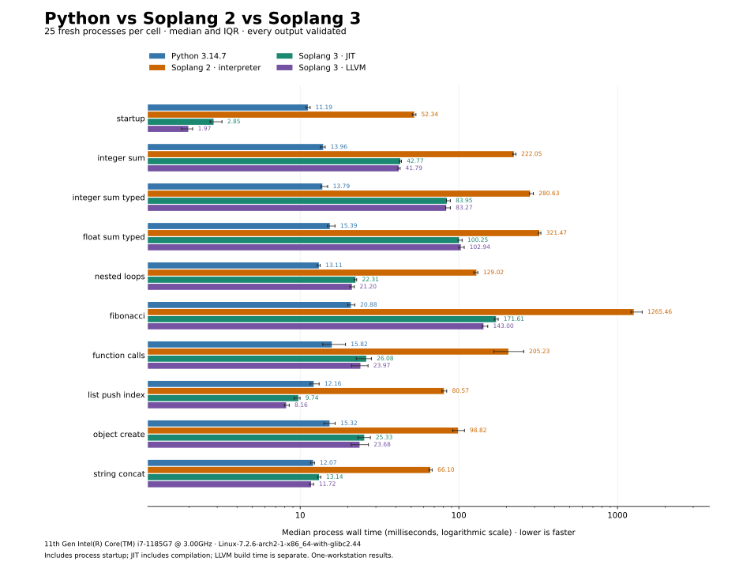

# Soplang benchmark results

## Python vs Soplang 2 vs Soplang 3

Measured **2026-10-17** on an **Intel Core i7-1185G7**, Linux x86_64, using
**CPython 3.14.7** for both the Python baseline and the v2 interpreter.
The v3 compiler was built in Cargo release mode; LLVM executables used optimization level 2.

Ten workloads, four execution modes, **25 measured runs and 5 warmups per cell**:
**1,000 measured processes**, each checked for the expected output and a successful exit.
Engine order was interleaved with a fixed seed and processes were pinned to logical CPU 2.

### Median wall time

All values are **milliseconds; lower is better**. Times include process startup.
JIT compilation is included. LLVM build time is recorded separately.

| Workload | Python 3.14.7 | Soplang 2 interpreter | Soplang 3 JIT | Soplang 3 LLVM |
| --- | ---: | ---: | ---: | ---: |
| startup | 11.194 | 52.342 | 2.846 | 1.972 |
| integer_sum | 13.960 | 222.053 | 42.774 | 41.791 |
| integer_sum_typed | 13.791 | 280.631 | 83.952 | 83.268 |
| float_sum_typed | 15.390 | 321.467 | 100.254 | 102.938 |
| nested_loops | 13.115 | 129.016 | 22.305 | 21.196 |
| fibonacci | 20.877 | 1265.457 | 171.612 | 142.999 |
| function_calls | 15.821 | 205.235 | 26.083 | 23.973 |
| list_push_index | 12.164 | 80.566 | 9.740 | 8.161 |
| object_create | 15.321 | 98.817 | 25.334 | 23.677 |
| string_concat | 12.075 | 66.099 | 13.142 | 11.718 |

### Findings

- Across the nine compute workloads, v2/v3 median-time ratios range from **3.2–8.3× for JIT** and **3.1–9.9× for LLVM**. Startup is a separate row.
- Python has lower median times on most compute workloads. V3 has lower whole-program latency for startup and list append/index; the LLVM string result is close to Python, with overlapping interquartile ranges.
- Typed accumulators are slower than the dynamic accumulator in these fixtures. Type annotations alone do not establish a performance gain; remaining type checks and conversions need profiling.
- Short-program latency includes interpreter startup. These results do not establish that v3 has a faster list inner loop than Python, nor do they measure memory use or sustained service throughput.

### Evidence and reproduction

- [Detailed results](comparison/RESULTS.md): ratios, interquartile ranges, workload definitions, and separate LLVM build costs.
- [Raw CSV samples](comparison/samples.csv) and [JSON metadata](comparison/results.json): all observations, tool versions, commands, CPU affinity, and source/binary hashes.
- [Reproduce the measurements](comparison/README.md): environment setup, runner options, and chart generation.



### Source revisions

- Soplang 2: tag `v2.0.0`, commit `b9f6457715e90028237239065f22ad7daa674d0b`. The tagged source reports `2.0.0-beta` internally.
- Soplang 3.0.0: commit `0a3d36e44dd65a0add6f6dac285d774e439d37ff`. The measured compiler source tree had no changes.

## Internal Criterion results

The [historical Criterion report](CRITERION_RESULTS.md) contains older, in-process
compiler measurements. Its February 2026 numbers use another revision and timing boundary.
They are separate from the fresh-process comparison above.

```sh
# Regenerate only the internal Criterion report.
bash benchmarks/run_benchmarks.sh
```

This command writes `benchmarks/CRITERION_RESULTS.md`. To regenerate the Python/v2/v3
measurements, use [the comparison runner](comparison/README.md#reproduce).
